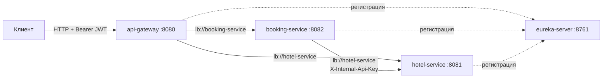

# StayFlow

Платформа бронирования отелей на Spring Boot и Spring Cloud: API Gateway, Eureka, два доменных сервиса, JWT-аутентификация и сага подтверждения бронирования с компенсацией.

Учебный проект по курсу «Фреймворк Spring и работа с REST API» (НИЯУ МИФИ).

## Содержание

- [Архитектура](#архитектура)
- [Модули](#модули)
- [Стек](#стек)
- [Требования](#требования)
- [Переменные окружения](#переменные-окружения)
- [Запуск](#запуск)
- [Быстрая проверка](#быстрая-проверка)
- [API](#api)
- [Тестовые пользователи](#тестовые-пользователи)
- [Тесты](#тесты)
- [Документация](#документация)
- [Ограничения](#ограничения)

## Архитектура



Ключевые особенности:

- database per service: у каждого сервиса своя in-memory H2, общих таблиц нет;
- сага-оркестрация в Booking: `PENDING` → `CONFIRMED` либо `PENDING` → `CANCELLED` с компенсацией через `POST /api/rooms/{id}/release`;
- идемпотентность: заголовок `Idempotency-Key` в Booking, таблица `processed_requests` в Hotel;
- устойчивость вызовов: Retry, TimeLimiter, CircuitBreaker (Resilience4j);
- трассировка: `X-Request-Id` → MDC `traceId`, `X-Booking-Id` → MDC `bookingId`;
- внутренние эндпоинты Hotel закрыты ключом `X-Internal-Api-Key` и заблокированы на Gateway.

Подробнее: [docs/architecture.md](docs/architecture.md), [docs/database.md](docs/database.md), [docs/api.md](docs/api.md), [docs/adr](docs/adr).

## Модули

| Модуль | Назначение | Порт |
|---|---|---|
| `common` | Общие DTO, ошибки, JWT, трассировка | - |
| `eureka-server` | Service Discovery | 8761 |
| `api-gateway` | Маршрутизация, JWT на входе, CORS, трассировка | 8080 |
| `hotel-service` | Отели, номера, доступность, статистика | 8081 |
| `booking-service` | Пользователи, бронирования, сага | 8082 |

## Стек

- Java 21
- Spring Boot 3.5.16
- Spring Cloud 2025.0.3 (Eureka, Gateway)
- Spring Security, JWT (HS256)
- Spring Data JPA, H2 in-memory
- Resilience4j 2.4.0
- Lombok, MapStruct
- springdoc-openapi (Swagger UI)
- JUnit 5, MockMvc, WireMock
- Maven 3.9, JaCoCo, Spotless (palantir-java-format), Enforcer

## Требования

- JDK 21
- Maven 3.9+
- Docker Desktop (для запуска через compose)

## Переменные окружения

Секреты в репозитории не хранятся. Значения задаются в файле `.env` в корне проекта; файл добавлен в `.gitignore`, в git попадает только шаблон `.env.example`.

```bash
cp .env.example .env
```

| Переменная | Назначение |
|---|---|
| `JWT_SECRET` | Base64-ключ HS256 для подписи и проверки токенов (не короче 32 байт в декодированном виде) |
| `INTERNAL_API_KEY` | Ключ внутренних эндпоинтов Hotel Service (`X-Internal-Api-Key`) |

Генерация значений:

```bash
openssl rand -base64 32   # JWT_SECRET
openssl rand -hex 32      # INTERNAL_API_KEY
```

Одно значение `JWT_SECRET` должно использоваться всеми сервисами: Booking выпускает токены, Gateway и Hotel их проверяют.

Тесты не зависят от `.env`: значения заданы в `src/test/resources/application-test.yml`.

## Запуск

Все сервисы в Docker:

```bash
docker compose up --build
```

Compose читает `.env` из корня проекта и передаёт переменные контейнерам. Порядок старта задан через healthcheck и `depends_on`: Eureka, затем Hotel и Booking, затем Gateway.

Локальный запуск одного сервиса без Docker (переменные окружения подхватываются из `.env`):

```bash
./scripts/run-local.sh eureka-server
./scripts/run-local.sh hotel-service
./scripts/run-local.sh booking-service
./scripts/run-local.sh api-gateway
```

Порядок запуска: Eureka, затем Hotel и Booking, затем Gateway. Каждый сервис запускается в отдельном терминале.

Остановить стек:

```bash
docker compose down
```

## Быстрая проверка

```bash
./scripts/smoke-test.sh
```

Скрипт ждёт готовности Gateway, регистрирует пользователя, читает отели и номера, создаёт бронирование с автоподбором и проверяет его в истории.

Swagger UI доступен на прямых портах сервисов:

- Hotel Service: http://localhost:8081/swagger-ui.html
- Booking Service: http://localhost:8082/swagger-ui.html

OpenAPI-спецификация: `/v3/api-docs` на том же порту.

## API

Все публичные запросы идут через Gateway на порт 8080, защищённые требуют `Authorization: Bearer <token>`.

| Метод | Путь через Gateway | Роль | Назначение |
|---|---|---|---|
| POST | `/api/auth/register` | публичный | регистрация, возвращает JWT |
| POST | `/api/auth/login` | публичный | вход, возвращает JWT |
| GET | `/api/users` | ADMIN | список пользователей |
| POST | `/api/users` | ADMIN | создать пользователя |
| PATCH | `/api/users` | ADMIN | обновить пользователя |
| DELETE | `/api/users?id={id}` | ADMIN | удалить пользователя |
| GET | `/api/hotels` | USER, ADMIN | список отелей с фильтрами и пагинацией |
| GET | `/api/hotels/{id}` | USER, ADMIN | отель по id |
| POST | `/api/hotels` | ADMIN | создать отель |
| PUT | `/api/hotels/{id}` | ADMIN | обновить отель |
| DELETE | `/api/hotels/{id}` | ADMIN | удалить отель |
| GET | `/api/hotels/{id}/statistics` | ADMIN | статистика загруженности отеля |
| GET | `/api/rooms` | USER, ADMIN | номера с фильтрами и пагинацией |
| GET | `/api/rooms/{id}` | USER, ADMIN | номер по id |
| GET | `/api/rooms/recommend` | USER, ADMIN | свободные номера по возрастанию `timesBooked` |
| POST | `/api/rooms` | ADMIN | создать номер |
| PUT | `/api/rooms/{id}` | ADMIN | обновить номер |
| DELETE | `/api/rooms/{id}` | ADMIN | удалить номер |
| POST | `/api/bookings` | USER, ADMIN | создать бронирование, требует `Idempotency-Key` |
| GET | `/api/bookings` | USER, ADMIN | история текущего пользователя |
| GET | `/api/bookings/{id}` | USER, ADMIN | бронирование по id |
| DELETE | `/api/bookings/{id}` | USER, ADMIN | отменить бронирование |

Внутренние эндпоинты Hotel Service не публикуются через Gateway и требуют `X-Internal-Api-Key`:

| Метод | Путь | Назначение |
|---|---|---|
| POST | `/api/rooms/{id}/confirm-availability` | подтвердить доступность и создать бронь слота |
| POST | `/api/rooms/{id}/release` | компенсация: снять бронь слота |

Пример:

```bash
TOKEN=$(curl -sS -X POST http://localhost:8080/api/auth/login \
  -H 'Content-Type: application/json' \
  -d '{"username":"user","password":"User123!"}' | jq -r .token)

curl -sS "http://localhost:8080/api/rooms/recommend?hotelId=1&startDate=2026-11-01&endDate=2026-11-05" \
  -H "Authorization: Bearer $TOKEN"

curl -sS -X POST http://localhost:8080/api/bookings \
  -H "Authorization: Bearer $TOKEN" \
  -H 'Content-Type: application/json' \
  -H "Idempotency-Key: demo-$(uuidgen)" \
  -d '{"hotelId":1,"startDate":"2026-11-01","endDate":"2026-11-05","autoSelect":true}'
```

Полное описание запросов, ответов и кодов ошибок: [docs/api.md](docs/api.md).

## Тестовые пользователи

Seed выполняется при старте (отключается через `stayflow.seed.enabled=false`):

| Логин | Пароль | Роль |
|---|---|---|
| `admin` | `Admin123!` | ADMIN |
| `user` | `User123!` | USER |

Seed Hotel Service: 3 отеля и 12 номеров с разным `timesBooked`, один номер выведен из эксплуатации (`available=false`).

## Тесты

```bash
export JAVA_HOME=$(/usr/libexec/java_home -v 21)
mvn clean verify
```

Покрыто:

- `common` - JWT, обработка ошибок, трассировка;
- `api-gateway` - маршрутизация, 401 в JSON, блокировка internal-эндпоинтов, удаление подделанного `X-Internal-Api-Key`;
- `hotel-service` - CRUD, фильтры, доступность, идемпотентность confirm/release, конкурентный доступ;
- `booking-service` - сага (успех, отказ, тайм-аут), идемпотентность, автоподбор, компенсация, recovery job, безопасность.

Отчёт покрытия: `target/site/jacoco/index.html` в каждом модуле.

## Документация

- [docs/architecture.md](docs/architecture.md) - компоненты, сага, устойчивость, трассировка;
- [docs/database.md](docs/database.md) - схема БД, таблицы, индексы, ER-диаграммы;
- [docs/api.md](docs/api.md) - справочник API, форматы ошибок, идемпотентность;
- [docs/testing.md](docs/testing.md) - запуск тестов, покрытие, сценарии проверки;
- [docs/adr](docs/adr) - архитектурные решения.

## Ограничения

- H2 in-memory: данные теряются при перезапуске сервиса, миграции не используются;
- CORS на Gateway открыт (`*`) для удобства разработки, для production нужен список origin;
- значения в `.env` - dev-секреты, в production переопределяются переменными окружения;
- recovery job работает внутри Booking, без брокера сообщений.
