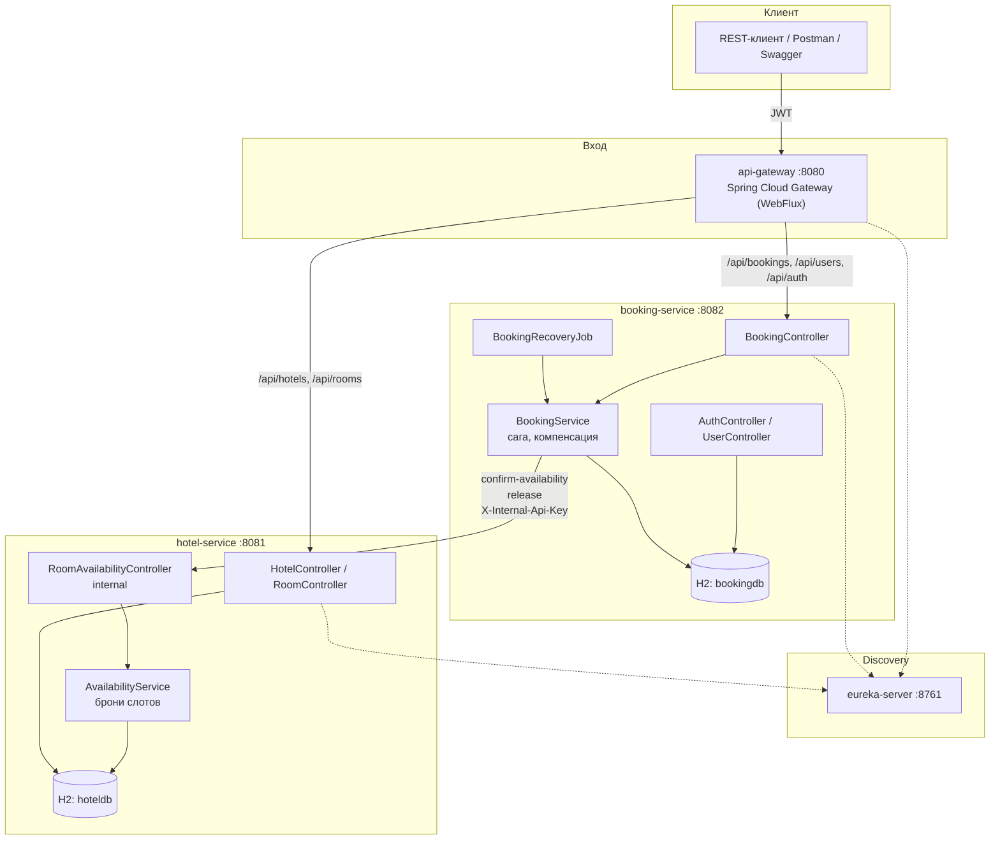
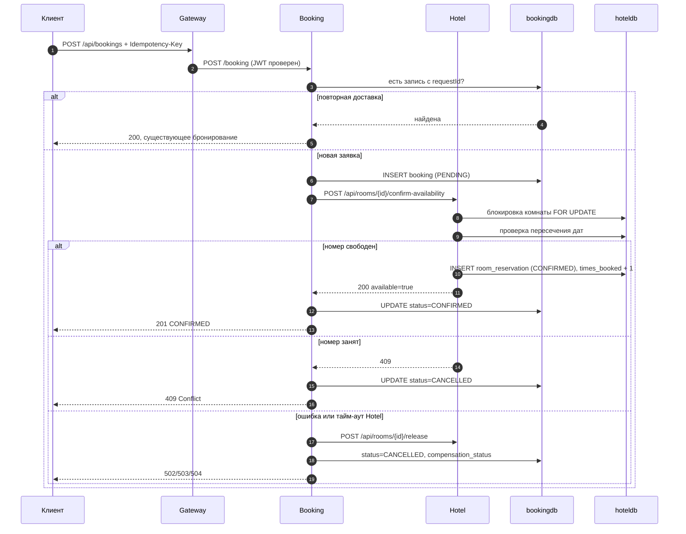

# Архитектура StayFlow

Ниже: состав сервисов, путь запроса, сага бронирования и то, что происходит при сбое Hotel.

## 1. Компоненты и границы

Границы:

- снаружи доступен только Gateway;
- Hotel Service публикует два внутренних эндпоинта, они защищены ключом и заблокированы на Gateway;
- у Booking и Hotel нет общей базы, согласованность держится на саге;
- Eureka не является точкой входа для клиентов.

### Ключевые классы

| Класс | Ответственность |
|---|---|
| BookingServiceImpl | оркестрация саги: создание, подтверждение, отмена, чтение |
| BookingStateService | локальные транзакции состояния и журнал booking_events |
| BookingRecoveryService | восстановление зависших PENDING и повтор компенсации |
| BookingRequestValidator | проверки Idempotency-Key, дат и тела повтора |
| BookingPriceCalculator | расчёт стоимости брони |
| AvailabilityServiceImpl | подтверждение доступности и release |
| RoomRecommendationService | рекомендации по times_booked |
| ReservationReplayService | повторная доставка внутренних вызовов |

## 2. Поток запроса

1. Клиент отправляет запрос на Gateway с `Authorization: Bearer <JWT>`.
2. Gateway проверяет токен (Resource Server, HS256, issuer `https://stayflow.example`), при ошибке возвращает JSON 401 в формате `ErrorDTO`.
3. Gateway блокирует пути `/api/rooms/{id}/confirm-availability` и `/api/rooms/{id}/release`, чтобы внутренние операции нельзя было вызвать снаружи.
4. Gateway удаляет присланный клиентом `X-Internal-Api-Key`, чтобы его нельзя было подделать.
5. Gateway добавляет `X-Request-Id`, если его нет, и маршрутизирует запрос через `lb://<service>` (разрешение имени через Eureka).
6. Сервис повторно проверяет JWT самостоятельно (Resource Server в каждом сервисе) и применяет `@PreAuthorize` на методах.
7. Сервис пишет `traceId` из `X-Request-Id` в MDC, все строки лога получают корреляцию.

Правила маршрутизации Gateway:

| Маршрут | Куда | Перезапись пути |
|---|---|---|
| `POST /api/auth/register` | booking-service | `/user/register` |
| `POST /api/auth/login` | booking-service | `/user/auth` |
| `/api/users/**` | booking-service | `/user/**` |
| `POST /api/bookings` | booking-service | `/booking` |
| `GET /api/bookings` | booking-service | `/bookings` |
| `/api/bookings/{id}` | booking-service | `/booking/{id}` |
| `/api/hotels/**, /api/rooms/**` | hotel-service | без изменений |

## 3. Сага подтверждения бронирования

Оркестратор - Booking Service. Глобальных транзакций нет, только локальные `@Transactional` в каждом сервисе.

Состояния бронирования:

| Состояние | Значение |
|---|---|
| `PENDING` | локальная запись создана, подтверждение из Hotel ещё не получено |
| `CONFIRMED` | Hotel подтвердил доступность, слот забронирован |
| `CANCELLED` | отказ Hotel, ошибка вызова или отмена пользователем |

Компенсация:

- при ошибке удалённого вызова Booking вызывает `release` и фиксирует `compensation_status`;
- `DONE` - слот снят сразу;
- `PENDING` - снять не удалось, задачу подхватывает recovery job;
- `NONE` - компенсация не требовалась.

## 4. Автоподбор номера

При `autoSelect: true` Booking получает список кандидатов от Hotel и перебирает их по порядку:

1. Booking вызывает внутренний `GET /api/rooms/internal/recommend` с `X-Internal-Api-Key` (пользовательский `GET /api/rooms/recommend` остаётся для клиентов) и получает свободные на даты номера, отсортированные по возрастанию `times_booked`, при равенстве - по `id`;
2. Booking пытается подтвердить первый номер;
3. при 409 (номер заняли параллельно) берёт следующего кандидата;
4. если кандидаты кончились, бронирование переводится в `CANCELLED`, клиент получает 409.

Такой порядок выравнивает загрузку: реже бронируемые номера предлагаются первыми, простой сокращается.

## 5. Идемпотентность

Booking:

- клиент обязан передать `Idempotency-Key`;
- значение сохраняется в `bookings.request_id` с уникальным ограничением;
- повторный запрос с тем же ключом возвращает существующее бронирование, дубль не создаётся;
- гонка двух одинаковых запросов разрешается уникальным индексом: проигравший ловит `DataIntegrityViolationException` и читает существующую запись;
- для внутренних вызовов ключи детерминированы: `UUID.nameUUIDFromBytes(requestId + ":confirm:" + roomId)` и `requestId + ":release"`.

Hotel:

- таблица `processed_requests` хранит `request_id`, операцию, `booking_id`, `room_id`, код результата и даты;
- повторный `confirm` с тем же ключом возвращает сохранённый результат, `times_booked` не увеличивается;
- повторный `release` идемпотентен, повторное снятие не ломает состояние;
- проверка идемпотентности выполняется до и после пессимистичной блокировки комнаты (`SELECT ... FOR UPDATE`), чтобы закрыть окно гонки.

## 6. Устойчивость вызовов

Настройки клиента Hotel в Booking (`HotelClientConfig`):

| Параметр | Значение |
|---|---|
| Retry | 3 попытки, экспоненциальная задержка 200 мс с множителем 2 |
| Повторяются | только `RemoteServiceException` (сетевые ошибки, 5xx) |
| Не повторяются | `RoomNotAvailableException`, `HotelClientException` (409 и клиентские 4xx) |
| TimeLimiter | 4 с на вызов, отмена зависшей задачи |
| CircuitBreaker | окно 10 вызовов, порог 50%, открыт 10 с, 3 пробных вызова в half-open |
| Исполнение | виртуальные потоки (`newVirtualThreadPerTaskExecutor`) |

Отображение ошибок наружу:

| Ситуация | Код ответа | `ErrorCode` |
|---|---|---|
| Hotel недоступен | 502 | `REMOTE_SERVICE_ERROR` |
| Circuit breaker открыт | 503 | `REMOTE_SERVICE_UNAVAILABLE` |
| Тайм-аут вызова | 504 | `REMOTE_TIMEOUT` |
| Номер занят | 409 | `CONFLICT` |
| Повтор с другим телом | 409 | `IDEMPOTENCY_CONFLICT` |

## 7. Recovery job

`BookingRecoveryJob` запускается каждые 30 секунд (`stayflow.booking.recovery.interval`) и делает две вещи:

1. находит бронирования в `PENDING` старше 2 минут (`pending-timeout`) и отменяет их с компенсацией;
2. находит бронирования с `compensation_status = PENDING` и повторяет `release`.

Если Hotel снова недоступен, попытка откладывается до следующего запуска, ошибка логируется. Брокер сообщений не нужен: планировщика внутри Booking достаточно при текущем объёме.

## 8. Трассировка и логирование

Заголовки (`TraceHeaders`):

| Заголовок | Назначение |
|---|---|
| `X-Request-Id` | корреляция запроса, генерируется на Gateway при отсутствии |
| `X-Booking-Id` | корреляция всех шагов одной саги |
| `X-Internal-Api-Key` | доступ к внутренним эндпоинтам Hotel |

MDC-поля: `traceId`, `bookingId`, `userId`. Логи пишутся в JSON через `logstash-logback-encoder` с `includeMdc`, поэтому все три поля попадают в каждую строку. Ключевые переходы состояний дополнительно сохраняются в `booking_events` с `trace_id`.

## 9. Безопасность

- JWT HS256, TTL 1 час, issuer `https://stayflow.example`;
- Gateway проверяет токен и возвращает JSON 401/403, сервисы проверяют повторно;
- роли: `USER` - свои бронирования и чтение каталога, `ADMIN` - CRUD отелей, номеров и пользователей, статистика;
- method security через `@PreAuthorize`, доступ к чужому бронированию закрыт проверкой владельца;
- внутренние эндпоинты Hotel: обязательный `X-Internal-Api-Key`, JWT не требуется;
- Gateway вырезает `X-Internal-Api-Key` из внешних запросов и блокирует сами пути;
- пароли хранятся в BCrypt, секреты приходят из переменных окружения.

## 10. Развёртывание

`docker-compose.yml` поднимает четыре сервиса в одной bridge-сети:

1. `eureka-server` с healthcheck на `/actuator/health`;
2. `hotel-service` после Eureka;
3. `booking-service` после Eureka и Hotel;
4. `api-gateway` после всех трёх.

Каждый образ собирается multi-stage (`maven:3.9-eclipse-temurin-21` → `eclipse-temurin:21-jre`), приложение работает от непривилегированного пользователя, healthcheck ходит в `/actuator/health`.
