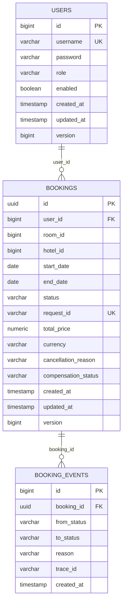
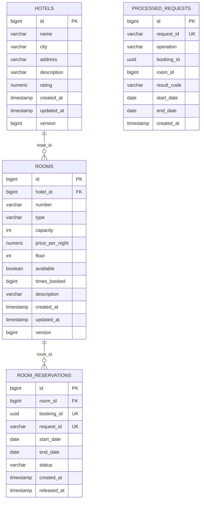

# Схема данных StayFlow

Каждый сервис владеет своей базой (database per service). Обе базы - H2 in-memory, схема создаётся Hibernate (`ddl-auto: create-drop`), поэтому данные живут только пока сервис запущен. Общих таблиц между сервисами нет: Booking хранит только идентификаторы `room_id` и `hotel_id`.

## 1. Booking Service (bookingdb)

### users

| Поле | Тип | Ограничения | Назначение |
|---|---|---|---|
| `id` | bigint | PK, identity | идентификатор |
| `username` | varchar(50) | not null, unique `uk_users_username` | логин |
| `password` | varchar(100) | not null | BCrypt-хеш |
| `role` | varchar(20) | not null, enum `USER`/`ADMIN` | роль |
| `enabled` | boolean | not null | признак активности |
| `created_at` | timestamp | not null | создание |
| `updated_at` | timestamp | not null | изменение |
| `version` | bigint | optimistic lock | защита от гонок |

Индекс: `idx_users_role` по `role`.

### bookings

| Поле | Тип | Ограничения | Назначение |
|---|---|---|---|
| `id` | uuid | PK | идентификатор бронирования, он же `bookingId` в трассировке |
| `user_id` | bigint | FK `fk_bookings_user`, not null | владелец |
| `room_id` | bigint | not null | номер в Hotel Service |
| `hotel_id` | bigint | nullable | отель, заполняется после подтверждения |
| `start_date` | date | not null, `start_date < end_date` | заезд |
| `end_date` | date | not null, `start_date < end_date` | выезд |
| `status` | varchar(20) | not null, enum `PENDING`/`CONFIRMED`/`CANCELLED` | состояние саги |
| `request_id` | varchar(100) | not null, unique `uk_bookings_request` | ключ идемпотентности (`Idempotency-Key`) |
| `total_price` | numeric | nullable | стоимость |
| `currency` | varchar | not null, по умолчанию `RUB` | валюта |
| `cancellation_reason` | varchar(500) | nullable | причина отмены |
| `compensation_status` | varchar(20) | not null, enum `NONE`/`PENDING`/`DONE` | состояние компенсации |
| `created_at` | timestamp | not null | создание |
| `updated_at` | timestamp | not null | изменение |
| `version` | bigint | optimistic lock | защита от гонок |

Индексы:

| Индекс | Колонки | Зачем |
|---|---|---|
| `idx_bookings_user_status` | `user_id, status` | история пользователя с фильтром по статусу |
| `idx_bookings_room_dates` | `room_id, start_date, end_date` | проверки пересечения дат |
| `idx_bookings_status_created` | `status, created_at` | поиск зависших `PENDING` для recovery job |
| `idx_bookings_compensation` | `compensation_status` | повтор компенсации |

### booking_events

Журнал переходов состояний.

| Поле | Тип | Ограничения | Назначение |
|---|---|---|---|
| `id` | bigint | PK, identity | идентификатор |
| `booking_id` | uuid | FK на `bookings`, not null | бронирование |
| `from_status` | varchar(20) | nullable | предыдущее состояние |
| `to_status` | varchar(20) | not null | новое состояние |
| `reason` | varchar(500) | nullable | причина перехода |
| `trace_id` | varchar(100) | nullable | корреляция с логами |
| `created_at` | timestamp | not null | время события |

Индекс: `idx_booking_events_booking_created` по `booking_id, created_at`.

## 2. Hotel Service (hoteldb)

### hotels

| Поле | Тип | Ограничения | Назначение |
|---|---|---|---|
| `id` | bigint | PK, identity | идентификатор |
| `name` | varchar(120) | not null | название |
| `city` | varchar(80) | not null | город |
| `address` | varchar(255) | not null | адрес |
| `description` | varchar(1000) | nullable | описание |
| `rating` | numeric(2,1) | nullable, 0.0...5.0 | рейтинг |
| `created_at` / `updated_at` | timestamp | not null | аудит |
| `version` | bigint | optimistic lock | защита от гонок |

### rooms

| Поле | Тип | Ограничения | Назначение |
|---|---|---|---|
| `id` | bigint | PK, identity | идентификатор |
| `hotel_id` | bigint | FK `fk_rooms_hotel`, not null | отель |
| `number` | varchar(20) | not null, unique в паре с отелем `uk_rooms_hotel_number` | номер комнаты |
| `type` | varchar(20) | not null, enum `SINGLE`/`DOUBLE`/`TWIN`/`SUITE`/`FAMILY` | тип |
| `capacity` | int | not null, 1...10 | вместимость |
| `price_per_night` | numeric | not null, > 0 | цена за ночь |
| `floor` | int | not null, >= 0 | этаж |
| `available` | boolean | not null, по умолчанию `true` | операционная доступность (ремонт, вывод из эксплуатации) |
| `times_booked` | bigint | not null, по умолчанию 0 | счётчик подтверждённых броней, основа автоподбора |
| `description` | varchar(500) | nullable | описание |
| `created_at` / `updated_at` | timestamp | not null | аудит |
| `version` | bigint | optimistic lock | защита от гонок |

Индексы: `idx_rooms_hotel` по `hotel_id`, `idx_rooms_available_times` по `available, times_booked` (выборка рекомендаций).

Важно: поле `available` не означает «свободен на даты». Занятость определяется таблицей `room_reservations` по пересечению интервалов.

### room_reservations

Бронь слота на даты. Создаётся только при подтверждении доступности.

| Поле | Тип | Ограничения | Назначение |
|---|---|---|---|
| `id` | bigint | PK, identity | идентификатор |
| `room_id` | bigint | FK `fk_reservations_room`, not null | номер |
| `booking_id` | uuid | not null, unique `uk_room_reservations_booking` | бронирование из Booking |
| `request_id` | varchar(100) | not null, unique `uk_room_reservations_request` | ключ идемпотентности вызова |
| `start_date` | date | not null, `start_date < end_date` | заезд |
| `end_date` | date | not null, `start_date < end_date` | выезд |
| `status` | varchar(20) | not null, enum `CONFIRMED`/`RELEASED` | состояние брони слота |
| `created_at` | timestamp | not null | создание |
| `released_at` | timestamp | nullable | время снятия |

Индексы: `idx_reservations_room_dates` по `room_id, start_date, end_date` (проверка пересечений), `idx_reservations_status` по `status`.

### processed_requests

Журнал обработанных внутренних запросов, обеспечивает идемпотентность `confirm-availability` и `release`.

| Поле | Тип | Ограничения | Назначение |
|---|---|---|---|
| `id` | bigint | PK, identity | идентификатор |
| `request_id` | varchar(100) | not null, unique `uk_processed_requests_request` | ключ запроса |
| `operation` | varchar(40) | not null | `CONFIRM` или `RELEASE` |
| `booking_id` | uuid | not null | бронирование |
| `room_id` | bigint | not null | номер |
| `result_code` | varchar(40) | not null | сохранённый результат для повтора |
| `start_date` / `end_date` | date | nullable | даты запроса |
| `created_at` | timestamp | not null | время обработки |

Индекс: `idx_processed_requests_booking` по `booking_id`.

## 3. Правила целостности

- `bookings.request_id` и `processed_requests.request_id` уникальны: повторная доставка не создаёт дубль;
- `room_reservations.booking_id` уникален: одно бронирование не может занять два слота;
- check-ограничения `start_date < end_date` защищают от перевёрнутых интервалов;
- проверка пересечения дат выполняется под `SELECT ... FOR UPDATE` по комнате, поэтому две параллельные брони на одни даты не проходят одновременно;
- `version` включает optimistic locking на пользователях, бронированиях, отелях и номерах.
